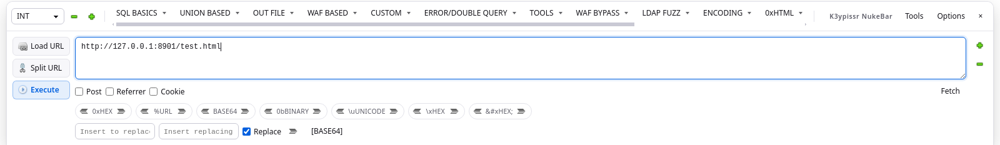

# K3ypissr NukeBar — Chrome

K3ypissr NukeBar 3.0.0 — the classic HackBar rebuilt for current Chromium browsers, merging HackBar v2.9 + Mod payloads with header replay, decoder, Admin Finder, Reverse IP and network viewer.

> Offensive security material. Use only against systems you own or have explicit permission to test.

## Screenshots



## Install (Chrome 116+)

1. Download this repo (or the `k3ypissr-nukebar-3.0-chrome.zip` release asset).
2. Open `chrome://extensions`, turn on **Developer mode**.
3. Click **Load unpacked** and pick this folder.
4. Press **F9** on any page to toggle the panel.

## What is included

- Merged SQL, WAF, UNION, LFI, XSS, encoding and tool menus — 3,652 payload entries across 177 menus (Pro: 3,440 items, Mod: 420 items, source-tagged P / M)
- Load URL, split URL, POST body, custom Referer and Cookie headers (via `declarativeNetRequest` session rules on Chromium)
- Response viewer with sandboxed preview and header table
- Local decoder / encoder toolkit and hash helpers
- Admin Finder wordlist scanner, Reverse IP lookup, network viewer
- DIOS / QUERY / XSS payload preferences and custom payloads
- Light and dark themes

Keyboard: `F9` toggle panel · `Alt+A` load current request · `Alt+X` execute · `Alt+S` split URL · `Alt+↑` / `Alt+↓` increment / decrement

## Layout

```
manifest.json          Manifest V3, Chrome 116+
background.js          Service worker: header replay, POST replay, viewer, network log
content/               Panel UI + payload engines (pro / mod / shared) + generated payloads
pages/                 Popup, options, about, poster, viewer, decoder, Admin Finder, Reverse IP, network, tamper, redirects
icons/                 Icon set
CREDITS.md             Full upstream credits — most payload text, menu labels, icons and handler logic were written by other people
LICENSE                GPL-2.0-or-later
```

## Credits / licence

Built from HackBar Pro v2.9 (Ph.Hitachi) and the 3xp10reX Mod, originating with Pedro Laguna and Johan Adriaans. See `CREDITS.md` for the full breakdown.

Released under the GNU General Public License, version 2 or later. This is an unofficial community rebuild — not affiliated with, endorsed by or supported by Mozilla, Google, Pedro Laguna, Ph.Hitachi, 3xp10reX or any other original author.

See also: **K3ypissr NukeBar — Firefox** — https://github.com/k3ypissr/nukebar-firefox (same 3.0.0 build for Firefox, plus the legacy XUL build for Firefox 1.5–6.0).
